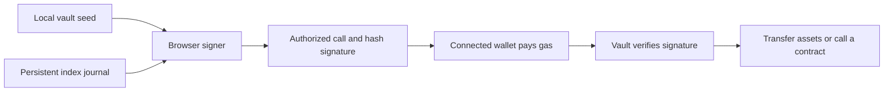

# EVM-Quantum-Vault

Smart-contract vaults with stateful, hash-based transaction authorization. The repository includes Solidity contracts, a TypeScript signing client, a browser interface, and local EVM tests.

Users create an independent vault address, deposit assets, and authorize outgoing calls with a locally generated vault key. An ordinary wallet submits transactions and pays gas; it does not replace the vault's signing key.

**Experimental and unaudited.** The current implementation supports **BNB Smart Chain mainnet (56) and testnet (97) only**. The EVM name describes the execution environment, not support for every EVM chain. Read [SECURITY.md](SECURITY.md) before using or modifying the signer.

## What it implements

- A permissionless CREATE2 factory and vaults without an administrator or upgrade mechanism.
- CCHS-K-20: Keccak-based Winternitz one-time signatures, a two-layer Merkle tree, and on-chain subtree caching.
- BNB transfers and authenticated contract calls, including BEP-20 token transfers.
- Browser-based vault creation, backup import, deposits, outgoing transactions, and recovery to an independently generated replacement seed.
- Durable signing-index reservations in IndexedDB, with concurrent-tab coordination and refusal to sign when spending records are missing or corrupt.
- Pinned Solidity compilation and tests that exercise TypeScript-generated signatures against the actual contracts in a local EVM.

## How it works

The vault stores public hash-tree roots. A withdrawal carries a signature proving that the requested target, amount, and call data were authorized by a key belonging to those roots. The contract verifies the proof before making the call.

The first operation in a subtree includes both tree layers. Later operations in that subtree reuse its cached root, reducing the signature payload from **4,928 to 2,464 bytes**. These figures exclude transaction fields and other ABI-encoded arguments.



This changes **how outgoing operations are authorized**. Balances and transactions remain public. It does not encrypt deposited assets or make BSC consensus, ordinary wallets, or arbitrary token contracts quantum-resistant. CCHS-K-20 is a custom construction, not a claim of SLH-DSA certification.

## Quick start

Use **Node.js 24 or later** and npm.

```sh
git clone https://github.com/Dr-wick/EVM-Quantum-Vault.git
cd EVM-Quantum-Vault
npm ci --ignore-scripts
npm run check
npm run dev
```

Open `http://127.0.0.1:5174`. The public source has **no default deployed factory**. To create vaults on a live network, deploy and verify your own factory, then configure its address using [.env.example](.env.example). All `VITE_` values are public browser configuration; never put a private key in them.

To explore the complete browser flow without real assets, run the [local browser harness](docs/development.md#local-browser-harness).

## Documentation

| Document | Contents |
| --- | --- |
| [Architecture](docs/architecture.md) | Contracts, signature caching, key derivation, transaction flow, and recovery |
| [Development](docs/development.md) | Build, tests, local browser harness, factory deployment, and configuration |
| [Usage](docs/usage.md) | Create a vault, save backups, deposit, send, and rotate keys |
| [Security](SECURITY.md) | Threat model, stateful-signature limits, and vulnerability reporting |

## Repository layout

```text
contracts/          Vault state machine, Keccak verifier, and CREATE2 factory
src/crypto/         Signing primitives, derivation, WASM support, and journal
src/vault/          Shared encodings, chain reads, operation flow, and recovery
src/vault.worker.ts Worker-based key generation and signing
src/VaultPage.tsx   Browser vault interface
src/generated/     Generated contract ABI and bytecode
scripts/            Compilation, deployment, CLI demo, and browser harness
tests/              Cryptographic, journal, client, and local EVM tests
docs/               Architecture, development, and usage guides
```

## Compatibility and scope

Names such as `BscQuantumVault`, the `bsc-quantum-vault/account/v1` derivation domain, `BQV_EXECUTE_V1`, and backup format identifiers are retained protocol identifiers. Changing the public project name does not migrate deployed vaults, keys, browser records, or backups. Do not replace those identifiers as a cosmetic rename.

The browser interface primarily manages BNB. Token operations require an explicitly encoded contract call. No protocol token, yield strategy, or deposit encryption is implemented.

## License and origin

Released under the [MIT License](LICENSE). The contract verifier and cryptographic client adapt MIT-licensed work from [Aegis Protocol](https://github.com/imadegoodstuff/aegis-protocol), with a rewritten interface and changes to derivation, signing domains, network scope, factory behavior, and state management. See [NOTICE](NOTICE) for the pinned upstream revision and attribution. This is an independent project, with no claim of upstream endorsement.
